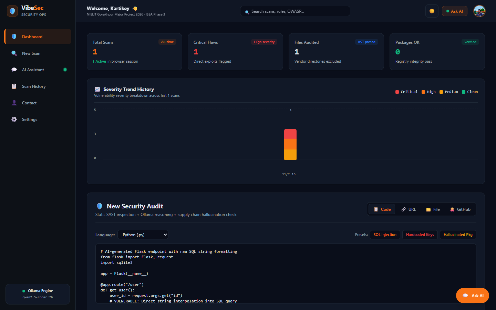
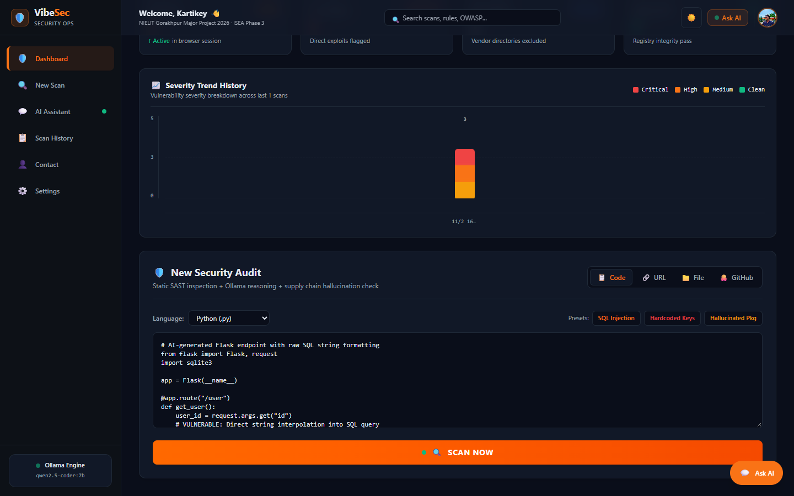
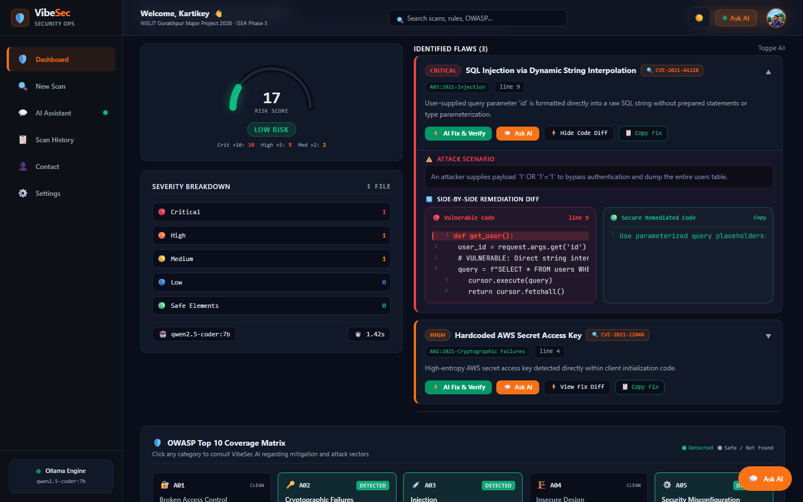
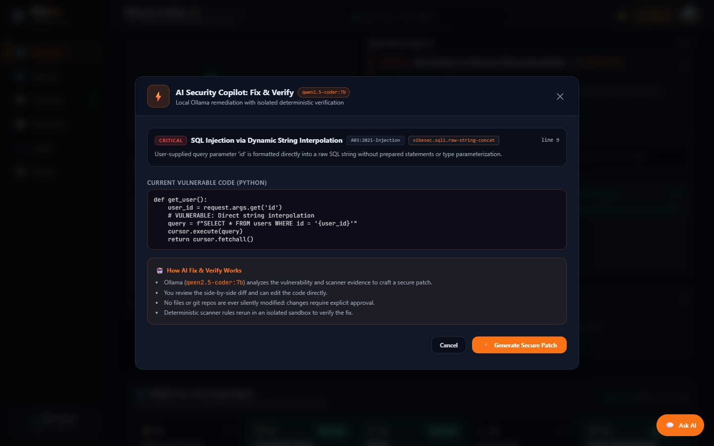
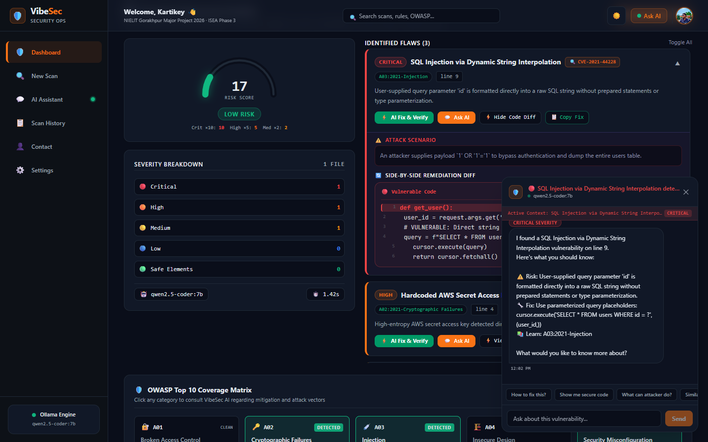
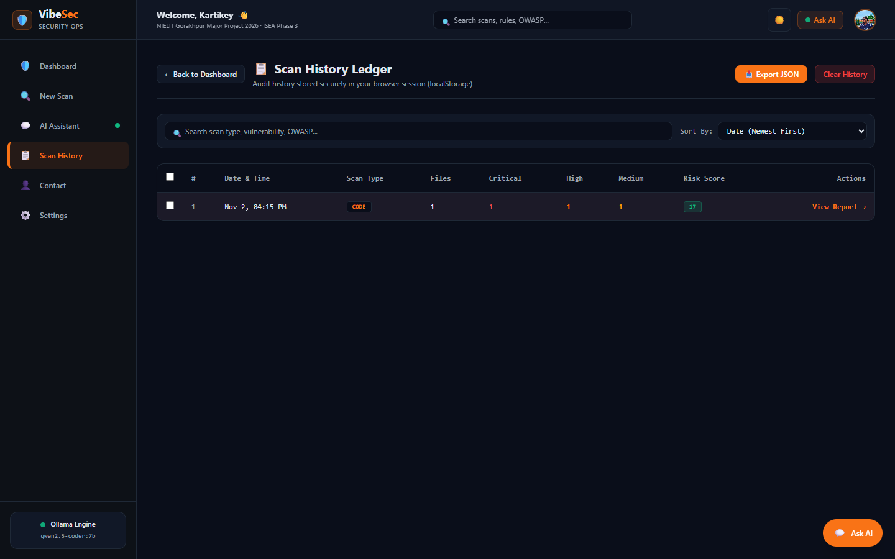
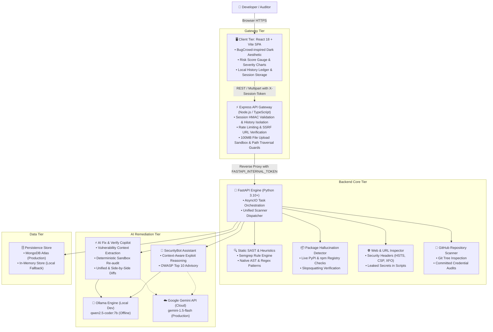

<div align="center">

# 🛡️ VibeSec AI

**Next-Generation AI Code Security Scanner, Real-Time Supply Chain Defense & Automated Vulnerability Remediation**

[](https://www.typescriptlang.org/)
[](https://react.dev/)
[](https://vitejs.dev/)
[](https://fastapi.tiangolo.com/)
[](https://www.python.org/)
[](https://ollama.com/)
[](https://ai.google.dev/)
[](LICENSE)

*Developed by **Kartikey Vishwakarma** as a Major Project at **NIELIT Gorakhpur** under the **Information Security Education and Awareness (ISEA Phase 3)** initiative.*

---

</div>

## 📑 Table of Contents

- [Overview & Problem Statement](#-overview--problem-statement)
- [Screenshots & Product Preview](#-screenshots--product-preview)
- [Key Features](#-key-features)
- [System Architecture & Data Flow](#-system-architecture--data-flow)
- [Engineering Highlights & Technical Skills](#-engineering-highlights--technical-skills)
- [Feature Walkthrough](#-feature-walkthrough)
- [Local Installation & Setup (Windows)](#-local-installation--setup-windows)
- [Environment Configuration](#-environment-configuration)
- [Testing & Quality Assurance](#-testing--quality-assurance)
- [Deployment Architecture](#-deployment-architecture)
- [Project Roadmap](#-project-roadmap)
- [Author & Academic Credit](#-author--academic-credit)

---

## 🎯 Overview & Problem Statement

Modern software engineering increasingly leverages AI code generation tools. However, AI-generated code frequently introduces severe security flaws:
1. **Insecure Coding Patterns**: Unparameterized SQL strings, command execution via shell interpolation, hardcoded secrets, and unsafe deserialization.
2. **AI Package Hallucination ("Slopsquatting")**: AI models frequently invent plausible-sounding library names (e.g., `jwt-super-auth-v2-guard`) that do not exist on public package registries. Attackers register these unclaimed names to execute arbitrary code upon installation.
3. **Superficial AI Fixes**: Many AI assistants generate replacement code that introduces secondary vulnerabilities or fails to eliminate the root cause.
4. **Session & Data Leakage**: Conventional multi-user audit tools often risk leaking audit logs, code snippets, or session findings across users.

**VibeSec AI** addresses these challenges through a unified, defense-in-depth security platform. It pairs static analysis (Semgrep, AST heuristics, Bandit) with **AI-powered reasoning** (local Ollama or Google Gemini) and features an **AI Fix & Verify Copilot** that deterministically re-tests synthesized patches in an isolated sandbox before recommending changes.

---

## 📸 Screenshots & Product Preview

All preview images reflect the actual running application with realistic security demonstration scenarios.

### 1. Security Operations Dashboard
The main dashboard provides real-time posture metrics (Total Audits, Critical Flaws, Files Inspected, Supply Chain Pass Rate), a historical severity trend chart, and the unified scan input panel.



---

### 2. Multi-Vector Code Scanner
Supports direct code pasting across Python, JavaScript, TypeScript, Go, Java, and PHP, with quick-load presets for SQL Injection, Hardcoded Secrets, and Hallucinated Package attacks. Additional tabs support live URL scanning, multi-file/ZIP uploads (up to 100MB), and public GitHub repositories.



---

### 3. Vulnerability Findings & Risk Assessment
Displays an aggregate Risk Score gauge, severity breakdown, OWASP Top 10 coverage matrix, attack scenarios, and an interactive side-by-side remediation diff.



---

### 4. AI Fix & Verify Copilot (Signature Feature)
Analyzes detected flaws with LLM reasoning, synthesizes secure patches, displays unified diffs, and reruns static scanner rules in an isolated sandbox to deterministically verify that the vulnerability is resolved before presenting the fix.



---

### 5. Contextual AI Security Assistant
An interactive chatbot powered by Ollama or Gemini that automatically inherits active vulnerability context (rule ID, code snippet, line number, OWASP category) to guide developers through remediation.



---

### 6. Scan History Ledger & Session Isolation
Audit history is tracked in a browser ledger isolated by cryptographic HMAC session tokens (`X-Session-ID` + `X-Session-Token`). Users can filter, sort, export audit snapshots to JSON, or inspect past scans.



---

## 🚀 Key Features

| Feature | Description |
| :--- | :--- |
| **Multi-Vector Scanning** | Scan raw code snippets, live web URLs, uploaded source archives/ZIPs (up to 100MB), or public GitHub repositories. |
| **Supply Chain Defense** | Actively detects AI-hallucinated dependencies by verifying declared packages against live PyPI and npm registries in real time. |
| **AI Fix & Verify** | Generates contextual remediation patches using LLMs and deterministically re-audits the patched code in an isolated sandbox. |
| **Contextual AI Chatbot** | Interactive security assistant with automated vulnerability context handoff for tailored explanations and exploit walk-throughs. |
| **OWASP & CWE Mapping** | Automatically tags each finding with relevant OWASP Top 10 (2021) categories and CVE/CWE reference identifiers. |
| **Cryptographic Session Isolation**| Enforces HMAC SHA-256 session tokens to guarantee that audit history and uploaded files remain strictly isolated per session. |
| **Dual AI Provider Architecture** | Runs 100% locally and privately with **Ollama** (`qwen2.5-coder:7b`) for offline development, or scales with **Google Gemini API** (`gemini-1.5-flash`) for cloud production. |

---

## 🏗️ System Architecture & Data Flow

VibeSec follows a decoupled, three-tier architecture designed for defense-in-depth, strict separation of concerns, and resilience against server-side request forgery (SSRF).



### Data Flow Overview
1. **User Action**: The auditor pastes code, uploads a project archive, or inputs a URL/GitHub repository.
2. **Gateway Verification**: The Express API gateway validates the request, enforces rate limits, checks for SSRF, sanitizes file names, and verifies session authentication.
3. **Dispatch & Parallel Analysis**: The FastAPI backend runs static analysis patterns and supply chain checks concurrently via `asyncio.gather`.
4. **AI Reasoning**: Potential findings are analyzed using LLM reasoning (Ollama locally or Gemini in cloud) to filter false positives and formulate attack scenarios.
5. **Deterministic Verification**: When requesting a patch via **AI Fix & Verify**, the synthesized code is re-tested in an isolated temporary sandbox to verify rule clearance before presenting the diff to the auditor.

---

## 💡 Engineering Highlights & Technical Skills

This project demonstrates core competencies across multiple engineering domains:

### 1. Software Engineering & Systems Design
- **Modern Full-Stack Stack**: React 18 with Vite, TypeScript, TailwindCSS, Node.js Express Gateway, and Python FastAPI.
- **Resilient Architectural Decoupling**: Express handles perimeter traffic and file ingestion; FastAPI handles compute-intensive analysis; static and AI engines operate independently.
- **Non-Blocking Concurrency**: Uses Python `asyncio` to execute static heuristics, package registry HTTP lookups, and AI model queries in parallel.

### 2. Cybersecurity Engineering
- **SAST & Heuristic Engineering**: Implements custom regex and AST pattern matchers alongside Semgrep integration for CWE-89 (SQLi), CWE-78 (Command Injection), CWE-798 (Hardcoded Credentials), and CWE-502 (Insecure Deserialization).
- **Supply Chain Defense**: Live registry checking against PyPI and npm to mitigate AI package hallucination risks before malicious dependencies can be introduced.
- **Defense-in-Depth Web Security**: Mitigates SSRF via private IP blocks, defends against path traversal in file uploads, restricts uploads to 100MB, and enforces strict Content Security Policy headers.
- **Session Isolation**: Employs HMAC SHA-256 signed session tokens to prevent IDOR (Insecure Direct Object Reference) access to historical audit logs.

### 3. AI Engineering
- **Dual AI Provider Routing**: Supports zero-cloud-cost, privacy-first local inference using **Ollama** (`qwen2.5-coder:7b`) while providing turnkey fallback to cloud providers (**Google Gemini API**, **Groq**).
- **Deterministic Fix-and-Verify Pipeline**: Solves AI hallucination in code remediation by subjecting AI-generated patches to automated static analysis verification before developer acceptance.
- **Context-Aware Prompt Engineering**: Structured system prompts with strict JSON schemas, token bounds, and localized code snippet context.

---

## 🧭 Feature Walkthrough

### 1. Running a Code Audit
1. Navigate to the **New Scan** tab on the dashboard.
2. Select **Code**, choose **Python**, and click one of the quick presets (e.g., **SQL Injection**).
3. Click **SCAN NOW**. The progress indicator tracks the multi-stage pipeline: AST parsing, Semgrep heuristics, dependency registry checks, and AI reasoning.

### 2. Inspecting Vulnerabilities
1. Review the **Risk Score** and **Severity Breakdown** (Critical, High, Medium, Low).
2. Expand the detected vulnerability card to inspect:
   - Specific source lines and rule IDs.
   - The concrete **Attack Scenario** explaining how an adversary could exploit the vulnerability.
   - The **Side-by-Side Remediation Diff** comparing vulnerable code to secure practices.

### 3. Remediating with AI Fix & Verify
1. Click **AI Fix & Verify** on any detected flaw.
2. The modal displays the flaw context, vulnerable snippet, and explanation.
3. Click **Generate Secure Patch**. Ollama/Gemini synthesizes a remediation diff.
4. The system automatically runs deterministic verification against the patch. When verified, a green badge confirms that the vulnerability rule has cleared.
5. Click **Apply Fix to Editor** or copy the patch directly.

### 4. Consulting the AI Security Assistant
1. Click **Ask AI** on any vulnerability card or from the header.
2. The assistant opens with pre-populated vulnerability context (file, line number, OWASP category).
3. Ask follow-up questions such as *"How do I rewrite this query using SQLAlchemy ORM?"* or click quick-prompt chips.

### 5. Managing Scan History
1. Click **Scan History** in the navigation sidebar.
2. Search past scans by vulnerability title or sort by risk score.
3. Select audits and click **Export JSON** to generate machine-readable security reports.

---

## 💻 Local Installation & Setup (Windows)

### Prerequisites
- **Node.js**: v18.0.0 or higher
- **Python**: v3.10 or higher
- **Git**
- **Ollama** *(Optional for local AI)*: [Download Ollama](https://ollama.com/) and pull the coder model:
  ```powershell
  ollama pull qwen2.5-coder:7b
  ```

---

### Method A: Automated Start (Recommended for Windows)

The repository provides PowerShell management scripts that handle environment setup, health checks, and process management.

```powershell
# 1. Clone the repository
git clone https://github.com/KeyToCoding/VibeSec-Project.git
cd VibeSec-Project

# 2. Start all services (FastAPI Backend + Node/Vite Gateway)
.\scripts\Start-VibeSec.ps1

# To gracefully stop all background services when finished:
.\scripts\Stop-VibeSec.ps1
```

Once started, the services are accessible at:
- **Frontend Application**: `http://localhost:3000`
- **FastAPI Backend API**: `http://127.0.0.1:8000`
- **Interactive Swagger Docs**: `http://127.0.0.1:8000/docs`
- **Backend Health Check**: `http://127.0.0.1:8000/api/health`

---

### Method B: Manual Step-by-Step Setup

#### 1. Backend Setup (FastAPI)
```powershell
cd vibesec\backend

# Create and activate virtual environment
python -m venv .venv
.\.venv\Scripts\Activate.ps1

# Install Python dependencies
pip install -r requirements.txt

# Start FastAPI server
uvicorn main:app --host 127.0.0.1 --port 8000
```

#### 2. Frontend Setup (Express Gateway + Vite)
In a separate terminal window at the project root:
```powershell
# Install Node dependencies
npm install

# Start Express gateway & Vite dev server
npm run dev
```

Visit `http://localhost:3000` in your browser.

---

## ⚙️ Environment Configuration

Configuration templates are provided in `.env.example` and `vibesec/backend/.env.example`. Real `.env` files containing secrets are strictly excluded by `.gitignore`.

### Key Configuration Variables

| Variable | Scope | Default / Example | Purpose |
| :--- | :--- | :--- | :--- |
| `PORT` | Gateway | `3000` | Port for the Express gateway & Vite server |
| `FASTAPI_BACKEND_URL` | Gateway | `http://127.0.0.1:8000` | Target URL for the internal FastAPI backend |
| `FASTAPI_INTERNAL_TOKEN`| Gateway/Backend | *(32-char hex string)* | Shared internal token for reverse proxy security |
| `SESSION_SECRET` | Gateway/Backend | *(32-char hex string)* | Shared HMAC secret for session authentication |
| `AI_PROVIDER` | Backend | `ollama` (dev) / `gemini` (prod) | Active AI inference engine |
| `OLLAMA_BASE_URL` | Backend | `http://127.0.0.1:11434` | Endpoint for local Ollama service |
| `OLLAMA_MODEL` | Backend | `qwen2.5-coder:7b` | Primary local LLM for code remediation |
| `GEMINI_API_KEY` | Backend | *(optional in dev)* | Google Gemini API key for cloud inference |
| `GEMINI_MODEL` | Backend | `gemini-1.5-flash` | Cloud AI model identifier |
| `MONGODB_URI` | Backend | *(optional)* | MongoDB connection string (falls back to in-memory) |

---

## 🧪 Testing & Quality Assurance

The repository includes backend unit/integration tests and frontend TypeScript verification.

### Run Backend Integration Tests
```powershell
cd vibesec\backend
.\.venv\Scripts\python.exe -m unittest discover -s tests -p "test_*.py" -v
```
*Current test suite covers session isolation, tamper-evident HMAC validation, file upload limits, and remediation verification endpoints (29 tests passing).*

### Run Frontend TypeScript Checks & Build
```powershell
# TypeScript type check
npm run lint

# Production build validation
npm run build
```

---

## 🌐 Deployment Architecture

For detailed production deployment instructions across cloud platforms (**Netlify** for the React SPA, **Render** for the Express Gateway, and **Render** for the FastAPI service), refer to:

👉 **[DEPLOYMENT.md](DEPLOYMENT.md)**

*Note: The application is designed for local evaluation and cloud deployment readiness. No live production instances are running unless configured by the user.*

---

## 🗺️ Project Roadmap

- [x] **Static SAST Engine**: Rule heuristics for SQLi, Command Injection, Secrets, and Insecure Deserialization.
- [x] **Supply Chain Defense**: Real-time npm and PyPI hallucination verification.
- [x] **AI Fix & Verify**: Local patch generation with deterministic sandbox re-auditing.
- [x] **Session Isolation**: HMAC SHA-256 signed session credentials for audit ledger safety.
- [x] **Multi-Input Ingestion**: Code snippets, multi-file/ZIP archives, live URLs, and GitHub repos.
- [ ] **IDE Extensions**: VS Code and JetBrains plugins for real-time in-editor hallucination warnings.
- [ ] **CI/CD GitHub Action**: Automated PR scanning and fix suggestions in pull request workflows.
- [ ] **Container Image Auditing**: Static analysis for Dockerfiles and base image CVE matching.

---

## 👤 Author & Academic Credit

**Kartikey Vishwakarma**  
- **GitHub**: [@KeyToCoding](https://github.com/KeyToCoding)  
- **Repository**: [KeyToCoding/VibeSec-Project](https://github.com/KeyToCoding/VibeSec-Project)  
- **LinkedIn**: [linkedin.com/in/kartikey28](https://linkedin.com/in/kartikey28)  
- **Project Context**: Major Project 2026, National Institute of Electronics & Information Technology (NIELIT) Gorakhpur  
- **Program**: Information Security Education and Awareness (ISEA Phase 3)  

---

<div align="center">
<sub>Built with dedication for NIELIT Gorakhpur · ISEA Phase 3 Internship Project · 2026</sub>
</div>
