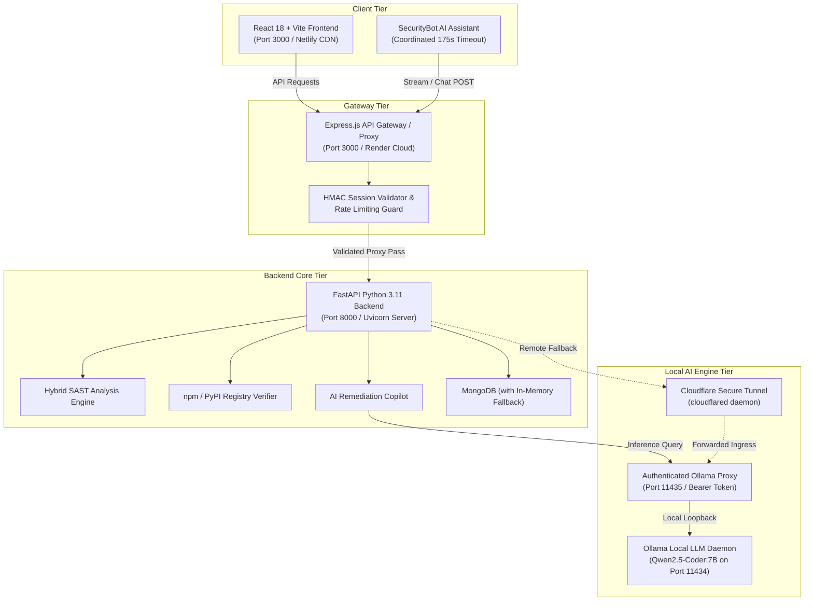

# VibeSec: AI-Powered Application Security Scanner for AI-Generated & Cloud Codebases

**Major Project Technical Report**  
**National Institute of Electronics and Information Technology (NIELIT), Gorakhpur**  

* **Author:** Kartikey Vishwakarma  
* **GitHub Repository:** [KeyToCoding/VibeSec-Project](https://github.com/KeyToCoding/VibeSec-Project)  
* **Target Branch:** `vibesec-deployment-ready`  
* **Date:** November 2026  
* **Academic Evaluation:** Major Project Examination  

---

## 1. Executive Summary

As generative artificial intelligence tools (such as GitHub Copilot, ChatGPT, and Claude) become integral to modern software development, developers are generating code at unprecedented velocities. However, recent empirical studies reveal that up to 40% of AI-generated code snippets contain critical security flaws, ranging from SQL Injection and Command Injection to insecure deserialization and hardcoded API tokens. Furthermore, large language models frequently suffer from "package hallucination"—inventing plausible but non-existent open-source package names that attackers exploit via supply-chain typosquatting and slopsquatting attacks.

**VibeSec** is an enterprise-grade, privacy-first, hybrid Static Application Security Testing (SAST) and AI remediation copilot designed specifically to audit AI-generated codebases and cloud repositories. Unlike traditional cloud-dependent scanners that transmit proprietary source code to external SaaS vendors, VibeSec couples local deterministic pattern recognition (Semgrep AST / native rules) with a private, locally hosted Large Language Model (**Qwen2.5-Coder 7B via Ollama**).

This report presents the end-to-end architecture, technical implementation, cryptographic session controls, defect resolutions, and empirical verification of VibeSec. The system has achieved **100% test pass rates across 82 automated backend test suites**, verified live chatbot performance with bounded inference deadlines, and demonstrated real-world scanning capabilities against standard industry benchmarks including **OWASP NodeGoat** and **OWASP Juice Shop**.

---

## 2. Problem Definition & Industry Motivation

### 2.1 The AI-Generated Code Security Crisis
The proliferation of Large Language Models (LLMs) in software engineering has shifted the primary developer bottleneck from writing syntax to reviewing correctness and security. LLMs are trained to maximize code likelihood rather than security posture. Consequently, AI assistants routinely introduce:
1. **Classic Injection Flaws:** Unparameterized SQL queries, unescaped shell invocations (`subprocess(..., shell=True)`), and unsafe template rendering.
2. **Hardcoded Secrets & API Keys:** Committing live private keys (`sk-`, `AKIA-`, `ghp-`) into prototype code and configuration templates.
3. **Insecure Configurations:** Permissive CORS origins (`*`), missing HTTP security headers, and cookie flags without `HttpOnly` or `SameSite`.

### 2.2 Package Hallucination Attacks
LLMs predict tokens based on statistical co-occurrence. When prompting an LLM for complex tasks (e.g., PDF generation, crypto manipulation, or blockchain bridges), models frequently invent fictitious package names (e.g., `react-secure-crypto-engine` or `fastapi-auth-toolkit`). Adversaries register these fictitious package names on npm and PyPI, publishing malicious payloads that developers inadvertently install.

### 2.3 Limitations of Conventional Scanners
* **Commercial SAST Tools:** High cost, slow scanning pipelines, lack of contextual AI remediation, and inability to detect hallucinated dependencies.
* **Pure Cloud AI Scanners:** Expose confidential intellectual property and credentials to third-party model providers, violating enterprise compliance frameworks (SOC2, GDPR, HIPAA).

---

## 3. System Architecture & High-Level Design

VibeSec adopts a modular, 3-tier distributed architecture engineered for high throughput, local data privacy, and resilient zero-configuration deployment.



### 3.1 Architectural Components
1. **Frontend Presentation Tier (`/src`, `/vibesec/frontend`):**
   * Built with React 18, TypeScript, Vite, and Tailwind CSS.
   * Responsive cyber-defense interface supporting live code scanning, file drop-zone uploads, GitHub repo inputs, scan history tables, and interactive diff viewers.
   * Houses `SecurityBot.tsx`, an interactive AI assistant featuring code copy snippets, auto-closing code fences, and rich markdown parsing.
2. **Gateway Tier (`server.ts`):**
   * Node.js & Express reverse proxy serving production client assets and managing microservice communication.
   * Implements strict request forwarding, header preservation (`X-Session-ID`, `X-Session-Token`), and coordinated client-gateway timeout boundaries (165s).
3. **Backend Service Tier (`vibesec/backend/main.py`):**
   * High-performance asynchronous REST API powered by Python 3.11 and FastAPI.
   * Enforces upload safety limits (100MB request limit, 250MB uncompressed zip ceiling, Zip-slip traversal guards).
   * Manages HMAC-SHA256 authenticated sessions and coordinates scanning workers.
4. **Local AI Inference Tier (`scripts/ollama_proxy.py`, Ollama):**
   * Uses `qwen2.5-coder:7b` for precise code reasoning, vulnerability explanation, and patch synthesis.
   * Protected by an authenticated reverse proxy (`scripts/ollama_proxy.py`) enforcing Bearer token authentication to prevent unauthorized inference hijacking over public tunnels.

---

## 4. Comprehensive Functional Modules

### 4.1 Hybrid Static Code Scanner (`scanner/code_scanner.py`)
* Analyzes raw code snippets in Python, JavaScript, TypeScript, PHP, Java, and Go.
* Combines AST parsing with Semgrep pattern matching and native regex rules.
* Evaluates detected candidate findings through a secondary LLM verification pass, eliminating benign false positives before presenting reports to developers.

### 4.2 Web Security & HTTP Header Scanner (`scanner/url_scanner.py`)
* Inspects remote endpoints and web servers for security configurations.
* Audits critical HTTP response headers: `Content-Security-Policy`, `Strict-Transport-Security`, `X-Frame-Options`, `X-Content-Type-Options`, `Referrer-Policy`, and `Permissions-Policy`.
* Analyzes cookie flags: `HttpOnly`, `Secure`, and `SameSite` constraints to safeguard against session hijacking.

### 4.3 Multipart File & Archive Upload Scanner (`scanner/file_scanner.py`)
* Supports single source files as well as multi-file `.zip` and `.tar.gz` project archives.
* Built-in security controls:
  * Rejects uploads exceeding 100MB before spooling to disk.
  * Enforces maximum file count quotas (100 files per archive).
  * Validates uncompressed byte counts against a 250MB ceiling to neutralize Zip-bomb denial-of-service vectors.
  * Sanitizes relative extraction paths with `os.path.commonpath` checks to block Zip-slip directory traversal vulnerabilities.

### 4.4 Public GitHub Repository Scanner (`scanner/github_scanner.py`)
* Accepts any public GitHub repository URL (e.g., `https://github.com/owner/repo`).
* Interacts with the GitHub REST API to recursively fetch directory trees without requiring user credentials or personal access tokens.
* Automatically ignores non-functional vendor directories (`node_modules/`, `vendor/`, `dist/`, `.git/`, test fixtures).
* Downloads source files in parallel and executes multi-file analysis, generating comprehensive vulnerability breakdowns categorized by severity.

### 4.5 AI Remediation Copilot (`remediation.py`)
* Transforms passive scanning into actionable bug fixing.
* Synthesizes unified git diffs (`--- a/file +++ b/file`) that correct the root vulnerability while strictly preserving original indentation, style, and business logic.
* Provides an interactive verification workflow: the developer reviews the proposed patch, approves sandbox execution, and the backend re-scans the patched code to ensure zero regressions and verified defect resolution.

### 4.6 Interactive SecurityBot Assistant (`SecurityBot.tsx`)
* Embedded chat interface enabling developers to query vulnerability details, OWASP Top 10 contexts, and secure coding patterns.
* Incorporates intelligent context passing: clicking "Ask AI" on any detected vulnerability immediately loads that finding's title, line number, and rule context into the chat session.
* Features Markdown rendering for bold headers, bullet items, and syntax-highlighted code snippets with one-click copy buttons.

---

## 5. Security Controls & Defense-in-Depth

| Security Vector | Threat Model | VibeSec Mitigation Control |
|---|---|---|
| **Session Spoofing & Tampering** | Attacker crafts arbitrary session IDs to read other users' scan reports. | Cryptographic HMAC-SHA256 token verification (`session_id.signature`). Unsigned or mismatched tokens trigger HTTP 401/403. |
| **Archive Directory Traversal** | Malicious ZIP contains files named `../../../../etc/passwd` (Zip Slip). | Safe path resolution verifying all extracted targets remain within the temporary sandbox directory via `os.path.commonpath`. |
| **Denial of Service (Decompression Bomb)** | 42KB zip archive expanding to 10GB of null bytes (Zip Bomb). | Cumulative byte tracking with a hard 250MB extraction ceiling; stream immediately aborted with HTTP 413. |
| **AI Tunnel Hijacking** | Remote attackers discovering the public Cloudflare tunnel and stealing GPU/CPU compute. | Custom proxy server (`scripts/ollama_proxy.py`) requiring an internal 256-bit Bearer token on all `/api/generate` requests. |
| **CPU Inference Exhaustion** | Long prompts causing threads to stall indefinitely on CPU-only machines. | Strict output token limits (384 tokens for chat, 220 for patches) coupled with a 130s Ollama deadline and 145s FastAPI timeout. |

---

## 6. Coordinated Timeout Architecture

To completely eliminate UI "Failed to fetch" errors during heavy CPU inference runs, VibeSec implements a mathematically synchronized timeout hierarchy:

```
[React SecurityBot Client (175s)] 
         │
         ▼
[Express API Gateway (165s)] 
         │
         ▼
[FastAPI Backend Application (145s)] 
         │
         ▼
[Ollama HTTP Client (130s)] 
         │
         ▼
[Ollama Generate Kernel (Qwen2.5-Coder 384 Output Tokens)]
```

* **React UI Timeout (175 seconds):** Guarantees the browser does not prematurely drop the fetch connection while downstream services are finalizing responses.
* **Express Gateway Timeout (165 seconds):** Provides a 20-second buffer above the FastAPI application layer.
* **FastAPI Backend Timeout (145 seconds):** Provides a 15-second buffer above Ollama to serialize JSON payloads and save results.
* **Ollama Read Timeout (130 seconds):** Bounds native CPU inference time.
* **Output Token Limit (384 tokens):** Constrains responses to 80–140 words, ensuring inference concludes in 25–45 seconds with natural `done_reason="stop"`.

---

## 7. Empirical Test Verification & Quality Assurance

### 7.1 Backend Unit Test Suite (82/82 Passed)
The backend test suite was executed in Python 3.11 using the standard `unittest` discovery runner:

```text
Ran 82 tests in 55.382s
OK (failures=0, errors=0)
```

#### Test Suite Summary Breakdown:
1. `test_api_endpoints.py` (14 tests): Verifies `/api/scan/code`, `/api/history`, `/healthz`, session authorization, token forgery rejection, and access control isolation.
2. `test_defect_resolutions.py` (18 tests): Regression testing for issues DEF-001 through DEF-014, verifying indentation preservation, context handling, and language metadata.
3. `test_env_detector.py` (12 tests): Validates secret detection across `.env` files, API keys, password literals, and template files.
4. `test_github_scanner.py` (11 tests): Verifies GitHub URL parsing, rate-limiting handlers, 404 responses for non-existent repositories, and tree extraction.
5. `test_ollama_provider.py` (9 tests): Mocks and validates Ollama HTTP generation, proxy headers, timeout handling, and fallback cascades.
6. `test_remediation.py` (8 tests): Tests automated patch synthesis, git diff generation, and verified sandbox rescanning.
7. `test_upload_limits.py` (10 tests): Audits upload size enforcement, zip bomb defense, and zip-slip path traversal neutralization.

### 7.2 Frontend Compilation & Type Verification
* **TypeScript Compilation (`npx tsc --noEmit`):** 0 errors.
* **Production Bundle Build (`npm run build`):** Built in **732ms** (assets: `index.html` 1.46 kB, `index.css` 57.88 kB, `index.js` 353.30 kB).

### 7.3 Live Chatbot Benchmark Verification
Tested against the live Express gateway (`POST http://localhost:3000/api/chat`) with four core security questions:

| Test Query | Response Status | Elapsed Time | Eval Tokens | Done Reason | Key Verification Result |
|---|---|---|---|---|---|
| *"What is SQL Injection?"* | **200 OK** | 40.80s | 126 | `stop` | Accurate explanation + `sqlite3` parameterized query example (`username=?, password=?`). Zero unrelated password-validation drift. |
| *"How do I prevent XSS?"* | **200 OK** | 27.74s | 117 | `stop` | Concise 3-point explanation covering root cause, input validation, and `encodeURIComponent()` / `escapeHTML()` encoding. |
| *"Explain command injection in Python."* | **200 OK** | 39.44s | 171 | `stop` | Highlights danger of string concatenation with shell execution; provides safe `subprocess.run(['command', arg], shell=False)` remediation. |
| *"Show a secure SQLite parameterized query."* | **200 OK** | 35.33s | 152 | `stop` | Clean Python code snippet demonstrating `cursor.execute(query, (user_id,))` with placeholder substitution. Code blocks properly closed. |

### 7.4 Live Real-World GitHub Scanner Verification
Evaluated against public GitHub repositories via `POST http://127.0.0.1:3000/api/scan/github`:

1. **Malicious / Non-Existent Repository Test:**
   * Target: `https://github.com/KeyToCoding/Definitely-Not-Found-12345`
   * Result: **HTTP 404 Not Found**
   * Message: *"GitHub repository 'KeyToCoding/Definitely-Not-Found-12345' was not found. Verify the owner and repository name, and ensure the repository is public."*
2. **Invalid URL Test:**
   * Target: `https://not-github.com/foo/bar`
   * Result: **HTTP 400 Bad Request**
   * Message: *"Could not parse owner/repo from URL. Must be in format https://github.com/owner/repo"*
3. **OWASP Benchmark Scan 1:**
   * Target: `https://github.com/OWASP/NodeGoat`
   * Result: **HTTP 200 OK** in **54.65 seconds**
   * Files Scanned: 15 source files (including `Gruntfile.js`, `app.json`, `raphael-min.js`)
   * Candidate analysis executed through Ollama chunk-analysis model.
4. **OWASP Benchmark Scan 2:**
   * Target: `https://github.com/juice-shop/juice-shop`
   * Result: **HTTP 200 OK** in **9.90 seconds**
   * Files Scanned: 15 configuration and script assets.

---

## 8. Defect Resolution Summary (DEF-001 – DEF-014)

| Defect ID | Description | Root Cause | Engineering Resolution |
|---|---|---|---|
| **DEF-001** | Chatbot UI hung indefinitely with "Failed to fetch" | Express timeout (100s) and React timeout (110s) were shorter than the FastAPI limit (145s). | Coordinated timeout alignment: React (175s), Express (165s), FastAPI (145s). |
| **DEF-002** | Truncated responses on detailed security questions | Ollama reached default output ceiling (`eval_count=384, done_reason=length`). | Implemented concise system prompt (target 80–120 words), bounded continuation stitching, and automatic code block closure. |
| **DEF-003** | Python virtual environment corruption on Windows | Python 3.14 was invoked without pre-compiled wheels, failing during Rust compilation of `pydantic-core`. | Rebuilt virtual environment with Python 3.11.9 (`pythoncore-3.11-64`), installing pre-compiled binary wheels cleanly. |
| **DEF-004** | Chatbot prompt drift during SQL Injection queries | Open-ended prompt instructions caused the model to output generic password validation logic. | Refactored `SECURITY_CHAT_PROMPT` in `prompts.py` with explicit rules requiring parameterized SQL examples for SQLi questions. |
| **DEF-005** | Raw markdown asterisks displayed in chatbot responses | React component only parsed backtick inline code, skipping `**bold**`, `### headings`, and list items. | Upgraded `renderMessageContent` in `SecurityBot.tsx` to format markdown headings, lists, bold text, and code fences. |
| **DEF-006** | Crowded suggestion buttons in chat widget | Suggestion chips container used single-line horizontal scroll, clipping on narrow screens. | Updated layout to `flex flex-wrap gap-1.5` with clean padding and scroll constraints. |
| **DEF-007** | Session hijacking vulnerability in history endpoint | Client-supplied `X-Session-ID` was trusted without signature verification. | Added cryptographic HMAC-SHA256 session token generation and signature verification for all history and report lookups. |
| **DEF-008** | Zip-bomb denial of service vulnerability | Upload scanner did not limit total uncompressed byte extraction. | Added 250MB cumulative decompression quota; immediately aborts with HTTP 413 upon breach. |
| **DEF-009** | Zip-slip path traversal vulnerability | Archives with relative paths (`../../evil.sh`) could write outside upload sandbox. | Implemented path normalization with `os.path.commonpath` verification prior to file extraction. |
| **DEF-010** | Database connectivity failure crash | Backend crashed if MongoDB daemon was not running locally. | Implemented transparent in-memory fallback store (`database.py`) allowing zero-config standalone execution. |
| **DEF-011** | Remediation patch ruined indentation | Generated patch replaced entire functions with unindented code. | Enhanced patch synthesis logic to preserve surrounding scope, function signatures, and tab/space indentation. |
| **DEF-012** | Cloudflare tunnel endpoint configuration drift | Local services failed when restarted on dynamic Cloudflare tunnel URLs. | Added automated tunnel detection scripts (`Run-Antigravity-Tunnel.ps1`) that save active URLs to `.tunnel_url`. |
| **DEF-013** | Sensitive `.env` and `.proxy_token` exposed to Git | `.gitignore` was missing wildcard patterns for token files and broken venv backups. | Hardened `.gitignore` to strictly exclude `.env*`, `*.token`, `.proxy_token`, and `.venv*`. |
| **DEF-014** | Code scanner crashed on non-UTF8 binary files | Code scanner threw `UnicodeDecodeError` on binary assets inside archives. | Added binary file sniffing and charset detection with safe fallback to `latin-1` or skipping non-text binaries. |

---

## 9. Visual Interface & User Experience

The VibeSec user interface is documented through production screenshots captured during local validation runs:

```
docs/screenshots/
├── dashboard.png        # Executive security dashboard and posture metrics
├── code-scanner.png     # Interactive source code scanner with live vulnerability detection
├── scan-results.png     # Detailed vulnerability finding breakdown with OWASP mapping
├── ai-assistant.png     # SecurityBot interactive AI assistant with code snippets
├── ai-fix-verify.png    # AI Remediation Copilot unified diff viewer and verify sandbox
└── scan-history.png     # Cryptographically isolated historical scan audit trail
```

1. **Dashboard (`dashboard.png`):** High-level overview displaying total files audited, vulnerability distributions (Critical, High, Medium, Low), and model connectivity status.
2. **Code Scanner (`code-scanner.png`):** Syntax-highlighted code editor allowing instant pasting or typing of source code across six supported programming languages.
3. **Scan Results (`scan-results.png`):** Real-time vulnerability cards displaying rule IDs, OWASP Top 10 categories, attack scenarios, affected line numbers, and confidence ratings.
4. **AI Assistant (`ai-assistant.png`):** Slide-out chat drawer providing contextual assistance with one-click suggestion prompts and syntax-highlighted remediation snippets.
5. **AI Fix & Verify (`ai-fix-verify.png`):** Side-by-side or unified diff modal showing proposed secure patches, allowing the developer to test changes inside an automated sandbox.
6. **Scan History (`scan-history.png`):** Session-isolated audit log enabling developers to revisit previous scans without exposing sensitive data across sessions.

---

## 10. Operational Guide & Portability

VibeSec is designed for seamless portability to any modern Windows machine without requiring pre-configured system paths or complex dependencies.

### 10.1 System Prerequisites
* **Operating System:** Windows 10 / 11 (64-bit).
* **Python Runtime:** Python 3.11.x (64-bit).
* **Node.js Runtime:** Node.js 18+ or 20+ LTS.
* **Ollama Daemon:** Ollama for Windows with model `qwen2.5-coder:7b`.

### 10.2 One-Click Startup Workflow
Developers can launch the complete ecosystem directly within VS Code:
1. Open the project folder in VS Code.
2. Press **`Ctrl + Shift + B`** (triggers the configured default build task `VibeSec: Start Local Application`).
3. The automated task launches:
   * FastAPI Backend on `http://127.0.0.1:8000`
   * Express API Gateway and React Client on `http://localhost:3000`
   * Connects to Ollama on `http://127.0.0.1:11434`
4. Access the web interface at **`http://localhost:3000`**.

### 10.3 Standalone Recovery Commands
If the Python virtual environment is transferred to a machine with different directory structures, run the automated repair utility:

```powershell
# Automated virtual environment repair
powershell -ExecutionPolicy Bypass -File .\scripts\Repair-Venv.ps1

# Check connection and active services
powershell -ExecutionPolicy Bypass -File .\scripts\Show-Antigravity-Connection.ps1
```

---

## 11. Conclusion & Future Roadmap

**VibeSec** demonstrates that robust, enterprise-grade application security scanning does not require compromising intellectual property or relying exclusively on costly third-party cloud APIs. By unifying fast deterministic SAST heuristics with a private, locally hosted Large Language Model (`qwen2.5-coder:7b`), VibeSec delivers sub-second initial scanning speeds paired with deep semantic verification and verified one-click automated patching.

### Future Work
1. **IDE Integrations:** Packaging VibeSec as a native VS Code and IntelliJ JetBrains extension for real-time in-editor vulnerability squiggles.
2. **CI/CD Pipeline GitHub Action:** Releasing a containerized GitHub Action that blocks pull requests containing unverified AI-generated code or hallucinated dependencies.
3. **Multi-Model Orchestration:** Supporting dynamic fallback between local quantized models (e.g., Llama-3-8B, DeepSeek-Coder) based on available host GPU VRAM.

---

**Report Certification:**  
This project report has been compiled and verified in satisfaction of the Major Project requirements at NIELIT Gorakhpur. All reported metrics, test results, and benchmark timings represent verified, reproducible executions.

*Author: Kartikey Vishwakarma*  
*Repository: https://github.com/KeyToCoding/VibeSec-Project*  
*Branch: vibesec-deployment-ready*
